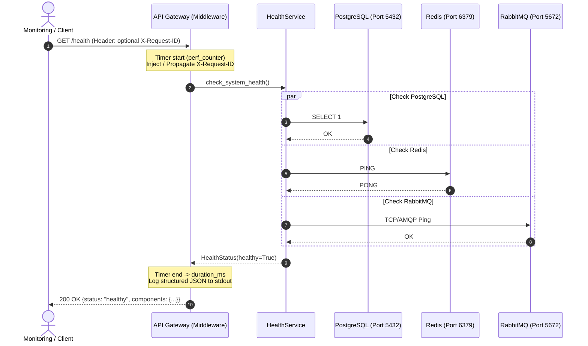

# Design: 00-project-bootstrap

## Context

Para habilitar el desarrollo distribuido de las tres etapas de la plataforma de ticketera virtual, se requiere un entorno de ejecución local Docker-only, gobierno de ramas, estándares de commit y una estructura de microservicios limpia basada en Arquitectura Hexagonal.

Referencias arquitectónicas:
- [ADR 001 - Arquitectura base de microservicios](file:///c:/Users/MAF/repos/UNLP-Tp-Topicos-2/docs/adr/001-Arquitectura%20base%20de%20microservicios.md)
- [ADR 005 - Observabilidad, bitácora de solicitudes HTTP y auditoría](file:///c:/Users/MAF/repos/UNLP-Tp-Topicos-2/docs/adr/005-Observabilidad,%20bit%C3%A1cora%20de%20solicitudes%20HTTP%20y%20auditor%C3%ADa.md)
- [ADR 012 - Requisitos no funcionales cuantificados](file:///c:/Users/MAF/repos/UNLP-Tp-Topicos-2/docs/adr/012-Requisitos%20no%20funcionales%20cuantificados.md)

## Goals / Non-Goals

**Goals:**
- Proveer un archivo `docker-compose.yml` que orqueste PostgreSQL 16, Redis 7, RabbitMQ 3 y el servicio API Gateway en Python 3.12 con un único comando (`docker compose up -d`).
- Inicializar automáticamente los 5 esquemas lógicos en PostgreSQL (`identity`, `catalog`, `ticketing`, `payments`, `reco`) y la extensión `pg_trgm` mediante script SQL montado en `/docker-entrypoint-initdb.d/`.
- Configurar la estructura de código del API Gateway bajo Arquitectura Hexagonal (`domain`, `application`, `infrastructure`).
- Implementar un middleware de observabilidad base que compute latencia en milisegundos (`duration_ms`) y propague `X-Request-ID` / `traceparent`.
- Actualizar `CONTRIBUTE.md` formalizando la política de ramas (`main` y `Development` protegidas), Conventional Commits, política de IA y el modelo de Lanes.
- Configurar CI en GitHub Actions (.github/workflows/ci.yml) para ejecutar linters y pruebas automáticas dentro del entorno contenedorizado.

**Non-Goals:**
- No incluye lógica de negocio de usuarios, catálogos ni checkout de tickets (reservado para los changes `01-auth-gateway`, `02-catalog-events` y `03-ticketing-checkout` de Etapa I).
- No incluye pasarela de pagos ni orquestación de la Saga transaccional.
- No incluye frontend Flask/HTMX (se integrará una vez expuestas las APIs de Etapa I).

## Decisions

### 1. Persistencia y Database-per-Service Lógico (ADR 001 y ADR 003)
- **Decisión:** Un único contenedor PostgreSQL 16 que crea en el arranque los esquemas `identity`, `catalog`, `ticketing`, `payments` y `reco`.
- **Alternativa descartada:** 5 contenedores PostgreSQL independientes. Descartado por consumo excesivo de memoria RAM local en máquinas de desarrollo.

### 2. Estructura Hexagonal en API Gateway
```
src/backend/
├── gateway/
│   ├── app/
│   │   ├── domain/          # Núcleo puro (sin dependencias externas)
│   │   │   └── models.py
│   │   ├── application/     # Casos de uso
│   │   │   └── health_service.py
│   │   └── infrastructure/  # Adaptadores HTTP y clientes de infraestructura
│   │       ├── api/
│   │       │   ├── routes/
│   │       │   │   └── health.py
│   │       │   └── middlewares/
│   │       │       └── request_logging.py
│   │       └── adapters/
│   │           ├── postgres_checker.py
│   │           ├── redis_checker.py
│   │           └── rabbit_checker.py
│   ├── main.py
│   ├── Dockerfile
│   └── requirements.txt
└── tests/
    └── test_health.py
```

### 3. Diagrama de Secuencia del Health Check (Mermaid)



### 4. Gobernanza de Lanes en CONTRIBUTE.md
- **Lane Docs (Documentación y ADRs):** Commits con prefijo `docs:` directos a ramas de feature de documentación sin necesidad de Issue previo; revisión simplificada.
- **Lane Code (Features y Bugfixes):** Requiere Issue previo en GitHub, rama `E{Etapa}-feature/<nombre>`, Conventional Commits, cobertura de tests unitarios/integración y 2 aprobaciones en PR.

## Risks / Trade-offs

- **[Riesgo]** Fallos de red o demoras en el arranque de PostgreSQL/RabbitMQ al ejecutar tests en CI.  
  *Mitigación:* Healthchecks nativos en `docker-compose.yml` (`condition: service_healthy`) y timeouts acotados de 2s en los sondas de verificación.
- **[Trade-off]** Compartir instancia PostgreSQL para los esquemas lógicos.  
  *Mitigación:* Regla estricta a nivel de código y CI que prohíbe JOINs inter-esquemas, garantizando la autonomía funcional de cada Bounded Context.

## Migration Plan

1. Actualizar `CONTRIBUTE.md`.
2. Crear script `docker/init-db/01-init-schemas.sql`.
3. Crear `docker-compose.yml` y `.env.example`.
4. Implementar estructura hexagonal del API Gateway en `src/backend/gateway/` con FastAPI y Python 3.12.
5. Crear suite de tests TDD `tests/test_health.py`.
6. Actualizar pipeline CI de GitHub Actions `.github/workflows/ci.yml`.
